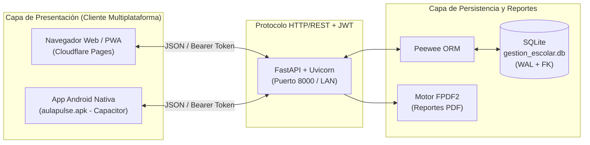
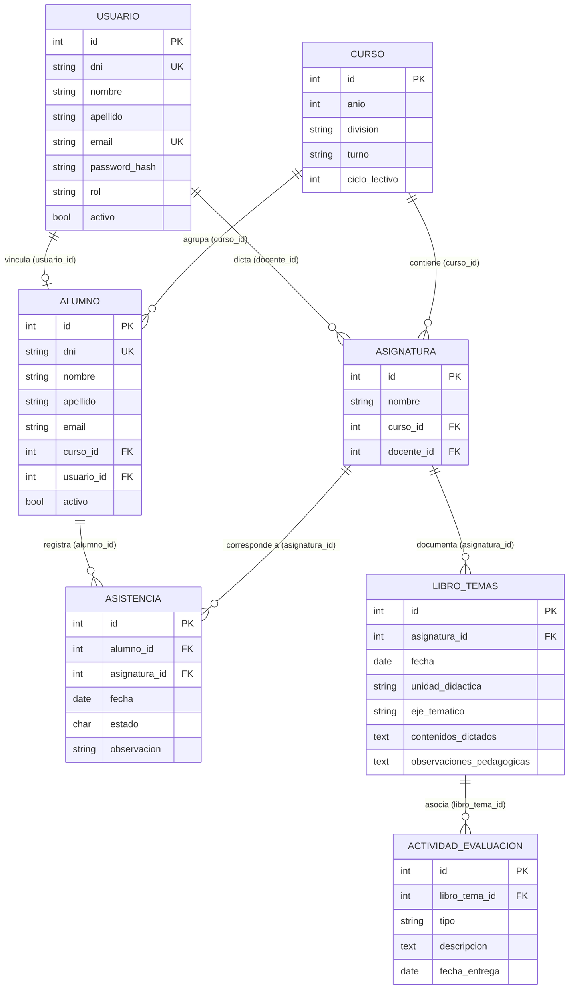

# INSTITUTO SUPERIOR DE FORMACIÓN DOCENTE "JUAN GARCÍA DE COSSIO"
### Tecnicatura Superior en Desarrollo de Software

 

---

# **AULAPULSE**
## Sistema de Gestión Escolar PWA y Aplicación Móvil Nativa
### Documentación Técnica Integral e Informe Final

---

 

**Materia:** Práctica Profesionalizante III

**Autores:**
Ramiro Curimá
Sebastián Gauna

**Institución:** I.S.F.D. "Juan García de Cossio" — San Roque, Corrientes, Argentina

**Fecha:** Noviembre de 2026

**Versión del Documento:** 1.0.0

---

## Índice

1. [Introducción y Alcance](#1-introducción-y-alcance)
   - 1.1 [Diagnóstico Situacional y Descripción del Problema](#11-diagnóstico-situacional-y-descripción-del-problema)
   - 1.2 [Objetivos del Sistema](#12-objetivos-del-sistema)
   - 1.3 [Público Destinatario y Roles](#13-público-destinatario-y-roles)
   - 1.4 [Alcance Funcional](#14-alcance-funcional)
2. [Arquitectura y Stack Tecnológico](#2-arquitectura-y-stack-tecnológico)
   - 2.1 [Visión General de la Arquitectura](#21-visión-general-de-la-arquitectura)
   - 2.2 [Frontend: React, Vite, Tailwind CSS y PWA](#22-frontend-react-vite-tailwind-css-y-pwa)
   - 2.3 [Backend: Python, FastAPI, Uvicorn y SQLite](#23-backend-python-fastapi-uvicorn-y-sqlite)
   - 2.4 [Despliegue y Distribución Multiplataforma](#24-despliegue-y-distribución-multiplataforma)
3. [Modelo de Base de Datos y Endpoints de la API REST](#3-modelo-de-base-de-datos-y-endpoints-de-la-api-rest)
   - 3.1 [Diseño Relacional y Normalización (3FN)](#31-diseño-relacional-y-normalización-3fn)
   - 3.2 [Diagrama Entidad-Relación (DER)](#32-diagrama-entidad-relación-der)
   - 3.3 [Diccionario de Tablas y Persistencia Complementaria](#33-diccionario-de-tablas-y-persistencia-complementaria)
   - 3.4 [Principales Rutas de la API REST](#34-principales-rutas-de-la-api-rest)
4. [Cumplimiento de Consignas — Práctica Profesionalizante III](#4-cumplimiento-de-consignas--práctica-profesionalizante-iii)
   - 4.1 [Alineación Teórica y Articulación Teórico-Práctica](#41-alineación-teórica-y-articulación-teórico-práctica)
   - 4.2 [Metodologías Ágiles Obligatorias (Scrum / Kanban Adaptado)](#42-metodologías-ágiles-obligatorias-scrum--kanban-adaptado)
   - 4.3 [Especificación de Requerimientos (RF y RNF) y Casos de Uso](#43-especificación-de-requerimientos-rf-y-rnf-y-casos-de-uso)
   - 4.4 [Módulos Funcionales Implementados](#44-módulos-funcionales-implementados)
   - 4.5 [Requisitos Técnicos Obligatorios](#45-requisitos-técnicos-obligatorios)
   - 4.6 [Anexo Obligatorio: Bitácora de Co-creación y Uso Ético de la IA](#46-anexo-obligatorio-bitácora-de-co-creación-y-uso-ético-de-la-ia)
5. [Conclusión y Conclusiones del Desarrollo](#5-conclusión-y-conclusiones-del-desarrollo)
6. [Referencias Bibliográficas (Normas APA 7.ª Edición)](#6-referencias-bibliográficas-normas-apa-7ª-edición)

---

## 1. Introducción y Alcance

### 1.1 Diagnóstico Situacional y Descripción del Problema

A partir de la observación directa y el relevamiento realizado durante las prácticas en terreno en el entorno educativo del I.S.F.D. "Juan García de Cossio" (San Roque, Corrientes), se identificaron cuellos de botella operativos recurrentes en la gestión académica diaria. Entre los principales inconvenientes detectados destacan:

1. **Fragmentación y soporte en papel:** El registro de asistencia diaria y el asentamiento de contenidos dictados (Libro de Temas) se realizan tradicionalmente en planillas físicas, lo que dificulta la consolidación de datos, incrementa el margen de error humano y retrasa la detección temprana de situaciones de riesgo académico.
2. **Demora en las alertas de ausentismo:** El cálculo manual de porcentajes de asistencia y faltas consecutivas impide que preceptores y directivos identifiquen en tiempo real cuándo un estudiante cae por debajo del umbral de regularidad institucional (75 %).
3. **Falta de movilidad en el aula:** Las soluciones de escritorio convencionales obligan a transcribir datos luego de la jornada escolar. Los docentes y preceptores requieren una herramienta *mobile-first* utilizable directamente desde el teléfono celular mientras recorren el aula, incluso en condiciones de conectividad intermitente.
4. **Dificultad para emitir documentación formal:** La confección manual de planillas de regularidad y actas de seguimiento pedagógico consume horas administrativas significativas.

Frente a esta problemática, surge **AulaPulse**, una Aplicación Web Progresiva (PWA) y aplicación móvil Android orientada a digitalizar, centralizar y agilizar el control de asistencia, el seguimiento del Libro de Temas Digital, la gestión de actividades evaluativas y la emisión automatizada de reportes institucionales en PDF.

### 1.2 Objetivos del Sistema

- **Objetivo General:** Diseñar, desarrollar y desplegar una plataforma integral de gestión escolar *mobile-first* que optimice el seguimiento académico diario de asistencia, contenidos áulicos y evaluaciones en instituciones educativas de nivel superior y medio.
- **Objetivos Específicos:**
  - Proveer una interfaz táctil ágil para la toma de asistencia en lote por asignatura y fecha con estados estrictos (`Presente`, `Ausente`, `Justificado`, `Tarde`).
  - Automatizar el cálculo de porcentajes de asistencia acumulada y la emisión de alertas tempranas por riesgo de regularidad (< 75 %) o inasistencias consecutivas (≥ 3).
  - Digitalizar el Libro de Temas y la vinculación de trabajos prácticos y fechas de evaluación por asignatura.
  - Garantizar la seguridad mediante autenticación basada en JWT y control de acceso por roles (`admin`, `preceptor`, `docente`, `alumno`).
  - Generar reportes institucionales estandarizados en formato PDF directamente desde el servidor.
  - Facilitar la distribución mediante despliegue web en la nube (Cloudflare Pages), servidor backend local de bajo consumo y paquete instalable nativo Android (`aulapulse.apk`).

### 1.3 Público Destinatario y Roles

El sistema segmenta sus capacidades operativas según cuatro perfiles de usuario:

| Rol | Identificador Técnico | Responsabilidades y Permisos Principales |
| :--- | :--- | :--- |
| **Administrador / Directivo** | `admin` | Gestión integral de usuarios, creación de cursos y asignaturas, supervisión de alertas de ausentismo, acceso a paneles de administración y descarga de reportes institucionales. |
| **Preceptor** | `preceptor` | Carga y corrección de asistencias en lote, monitoreo de alertas de regularidad y faltas consecutivas, matriculación de alumnos y exportación de planillas PDF. |
| **Docente** | `docente` | Toma de asistencia rápida en sus asignaturas, registro diario en el Libro de Temas Digital, carga de actividades/evaluaciones, seguimiento de trabajos prácticos y calificaciones. |
| **Alumno** | `alumno` | Autogestión de matriculación mediante enlace público de invitación (`/unirse/:curso_id`) y consulta de información académica asignada. |

### 1.4 Alcance Funcional

AulaPulse cubre el ciclo completo de gestión áulica diaria:
- Autenticación segura y registro de usuarios.
- Administración de estructura académica (Cursos por año/división/turno/ciclo lectivo, Alumnos y Asignaturas).
- Autogestión de inscripción de estudiantes mediante enlace directo por curso.
- Control de Asistencia de Estudiantes con carga en lote (*upsert*), cálculo en tiempo real y tablero de alertas.
- Libro de Temas Digital con registro de unidad didáctica, eje temático, contenidos, observaciones pedagógicas y actividades/evaluaciones asociadas.
- Vistas interactivas de Trabajos Prácticos y Calificaciones por asignatura.
- Generación de reportes oficiales en PDF (Planilla de Asistencia y Regularidad; Libro de Temas Digital).
- Instalabilidad multiplataforma como PWA (escritorio y móvil) y como APK nativo en Android.

---

## 2. Arquitectura y Stack Tecnológico

### 2.1 Visión General de la Arquitectura

AulaPulse implementa una **arquitectura Cliente-Servidor desacoplada** basada en el estilo arquitectónico REST (*Representational State Transfer*) (Fielding, 2000). El cliente (Frontend PWA / APK Android) consume los recursos expuestos por el servidor Backend a través de peticiones HTTP/HTTPS con intercambio de datos en formato JSON y autenticación *stateless* mediante *JSON Web Tokens* (JWT).

### 2.2 Frontend: React, Vite, Tailwind CSS y PWA

La interfaz de usuario se construyó bajo el principio **Mobile-First Estricto**, priorizando la ergonomía táctil para docentes y preceptores en movimiento:

- **React 19 (`react`, `react-dom`):** Biblioteca declarativa basada en componentes funcionales y *hooks* (`AuthContext`, `AsignaturaContext`, `useAsignaturaStore`), garantizando un flujo de estado predecible y modular.
- **React Router DOM 7 (`react-router-dom`):** Enrutamiento SPA con separación explícita entre rutas públicas (`/login`, `/registro`, `/unirse/:curso_id`) y rutas protegidas mediante JWT (`ProtectedRoute` y `AppLayout` con barra de navegación inferior `BottomNav`).
- **Vite 8 (`vite`, `@vitejs/plugin-react`):** Empaquetador de última generación con compilación ultrarrápida y configuración `base: './'` para compatibilidad tanto en hosting web como en contenedores locales de Capacitor.
- **Tailwind CSS 3 (`tailwindcss`, `autoprefixer`, `postcss`):** Framework CSS *utility-first* que permite construir interfaces responsivas, tarjetas tipo *glassmorphism* (`GlassCard`) y botones *tap-friendly* de alto contraste.
- **Framer Motion y Lucide React:** Micro-interacciones fluidas en tarjetas y listas junto a iconografía vectorial ligera.
- **PWA (`vite-plugin-pwa`):** Genera automáticamente el manifiesto web (`manifest.webmanifest` con `display: 'standalone'`, `orientation: 'portrait'`, `theme_color: '#1e1b4b'`) y el *Service Worker* (`sw.js` con Workbox) con estrategia `autoUpdate` para habilitar la instalación en pantalla de inicio y el caché de recursos estáticos.

### 2.3 Backend: Python, FastAPI, Uvicorn y SQLite

El núcleo de lógica de negocio fue diseñado siguiendo una filosofía **ultraliviana, sin dependencias pesadas** (prescindiendo deliberadamente de SQLAlchemy, Pandas u Openpyxl para maximizar la velocidad de arranque y facilitar el despliegue en hardware institucional modesto):

- **Python 3.12 + FastAPI:** Framework web asíncrono de alto rendimiento con validación automática de esquemas de entrada/salida mediante **Pydantic** y documentación interactiva OpenAPI/Swagger generada automáticamente.
- **Uvicorn:** Servidor ASGI de alto desempeño encargado de exponer la API REST en red local o entorno productivo.
- **Peewee ORM:** Mapeador Objeto-Relacional ligero y expresivo que facilita consultas SQL parametrizadas seguras frente a inyecciones SQL.
- **SQLite (`gestion_escolar.db`):** SGBD relacional embebido configurado con dos directivas `PRAGMA` críticas en `backend/database.py`:
  - `journal_mode = 'wal'` (*Write-Ahead Logging*): Permite lecturas y escrituras concurrentes sin bloqueos cuando múltiples docentes toman asistencia simultáneamente.
  - `foreign_keys = 1`: Activa la verificación estricta de integridad referencial a nivel de motor.
- **Seguridad (`backend/auth.py`):** Hash de contraseñas con **PBKDF2-HMAC-SHA256** (100.000 iteraciones y *salt* criptográfico aleatorio de 16 bytes por usuario, comparado con `hmac.compare_digest`) y emisión de tokens **JWT** (`HS256`, expiración de 480 minutos).
- **Reportabilidad (`backend/reportes.py`):** Generación nativa de documentos PDF institucionales mediante la librería **`fpdf2`**, con encabezados del I.S.F.D. "Juan García de Cossio", fecha de emisión y pie de página numerado.

### 2.4 Despliegue y Distribución Multiplataforma

El proyecto adopta una estrategia híbrida de despliegue adaptada a la realidad de las instituciones educativas:

1. **Frontend en la Nube (Cloudflare Pages):** El artefacto estático compilado en `frontend/dist/` se publica en Cloudflare Pages, brindando acceso HTTPS global con baja latencia y soporte nativo para la instalación de la PWA desde navegadores móviles y de escritorio.
2. **Servidor Local Backend:** El backend Python/FastAPI se ejecuta mediante Uvicorn en un servidor o equipo de la red institucional (LAN), manteniendo la soberanía y privacidad de la base de datos `gestion_escolar.db` dentro del establecimiento, con CORS habilitado para aceptar peticiones desde la PWA y la app móvil.
3. **Empaquetado Nativo Android (`aulapulse.apk`):** Mediante **Capacitor 8** (`@capacitor/core`, `@capacitor/android`, `appId: "com.isfdsanroque.aulapulse"`) y **Android Studio / Gradle**, la compilación web (`webDir: "dist"`) se encapsula en un proyecto Android nativo ubicado en `frontend/android/`, generando el archivo instalable **`aulapulse.apk`** (disponible también para descarga directa desde la vista `/instalacion` y `frontend/public/aulapulse.apk`).

---

## 3. Modelo de Base de Datos y Endpoints de la API REST

### 3.1 Diseño Relacional y Normalización (3FN)

El esquema relacional definido en `backend/models.py` cumple con la **Tercera Forma Normal (3FN)** (Codd, 1970):
- Cada tabla posee una clave primaria subrogada (`id` autoincremental) y atributos atómicos (1FN).
- Todos los atributos no clave dependen funcionalmente de la clave primaria completa (2FN).
- Se eliminan dependencias transitivas y columnas calculadas (3FN): por ejemplo, el porcentaje de asistencia y el estado de regularidad **no se almacenan** en la tabla `Alumno`, sino que se calculan dinámicamente a partir de los registros de `Asistencia`, evitando anomalías de actualización.

### 3.2 Diagrama Entidad-Relación (DER)

### 3.3 Diccionario de Tablas y Persistencia Complementaria

1. **`usuario` (`Usuario`):** Almacena credenciales, datos personales y rol (`admin`, `preceptor`, `docente`, `alumno`). Garantiza unicidad en `dni` y `email`.
2. **`curso` (`Curso`):** Normaliza las divisiones académicas (`anio`, `division`, `turno`, `ciclo_lectivo`).
3. **`alumno` (`Alumno`):** Datos del estudiante vinculados obligatoriamente a un `Curso` (`on_delete='RESTRICT'`) y opcionalmente a un `Usuario` (`on_delete='SET NULL'`).
4. **`asignatura` (`Asignatura`):** Vincula una materia con su `Curso` (`on_delete='CASCADE'`) y su `Usuario` docente (`on_delete='RESTRICT'`).
5. **`asistencia` (`Asistencia`):** Registra cada evento de presentismo por `alumno`, `asignatura` y `fecha`, con `estado` restringido al dominio `^[PAJT]$` (`P`: Presente, `A`: Ausente, `J`: Justificado, `T`: Tarde).
6. **`librotemas` (`LibroTemas`):** Asienta la continuidad pedagógica diaria (`unidad_didactica`, `eje_tematico`, `contenidos_dictados`, `observaciones_pedagogicas`).
7. **`actividadevaluacion` (`ActividadEvaluacion`):** Registra trabajos prácticos y evaluaciones (`tipo`, `descripcion`, `fecha_entrega`) vinculados a una entrada de `LibroTemas` (`on_delete='CASCADE'`).

> **Persistencia Complementaria en Frontend (Calificaciones y Trabajos Prácticos):** De forma complementaria, las vistas `Calificaciones.jsx` y `TrabajosPracticos.jsx` gestionan columnas de evaluación, notas numéricas (escala 0–10 con aprobación ≥ 6) y seguimiento de entregas por asignatura mediante el *hook* `useAsignaturaStore`, permitiendo a los docentes operar ágilmente desde la interfaz móvil.

### 3.4 Principales Rutas de la API REST

| Categoría | Método y Ruta | Roles Autorizados | Descripción Funcional |
| :--- | :--- | :--- | :--- |
| **Sistema** | `GET /` | Público | Verificación de estado (*health check*) del servicio FastAPI. |
| **Autenticación** | `POST /auth/login` | Público | Autenticación OAuth2 (*email* + contraseña); retorna `access_token` JWT y datos de perfil. |
| **Usuarios** | `POST /usuarios/` | `admin` | Alta de nuevos usuarios (`admin`, `preceptor`, `docente`, `alumno`) con hash PBKDF2. |
| **Cursos** | `POST /cursos/` | `admin`, `preceptor` | Creación de cursos/divisiones por año, turno y ciclo lectivo. |
| **Cursos** | `GET /cursos/` | Autenticado | Listado completo de cursos registrados. |
| **Alumnos** | `POST /alumnos/` | `admin`, `preceptor` | Alta administrativa de un estudiante en un curso. |
| **Alumnos** | `POST /alumnos/autogestion/` | Público | Automatriculación de alumno mediante enlace de invitación del curso. |
| **Alumnos** | `GET /alumnos/` | Autenticado | Listado de alumnos activos, filtrable opcionalmente por `curso_id`. |
| **Asignaturas** | `POST /asignaturas/` | `admin`, `preceptor` | Creación de asignatura asignando curso y docente titular. |
| **Asignaturas** | `GET /asignaturas/` | Autenticado | Listado de asignaturas (filtrado por docente o curso). |
| **Asistencias** | `POST /asistencias/lote/` | `admin`, `preceptor`, `docente` | Carga masiva (*upsert*) de asistencia diaria por asignatura y fecha (`P`, `A`, `J`, `T`). |
| **Asistencias** | `GET /asistencias/alertas/{curso_id}` | `admin`, `preceptor`, `docente` | Cálculo en tiempo real de porcentajes y detección de alertas (< 75 % o ≥ 3 faltas consecutivas). |
| **Libro de Temas** | `POST /libro-temas/` | `admin`, `docente` | Registro diario de unidad didáctica, eje temático, contenidos y observaciones. |
| **Libro de Temas** | `GET /libro-temas/{asignatura_id}` | Autenticado | Consulta cronológica del Libro de Temas de una asignatura. |
| **Actividades** | `POST /libro-temas/actividades/` | `admin`, `docente` | Vinculación de trabajos prácticos o evaluaciones a un registro del Libro de Temas. |
| **Reportes PDF** | `GET /reportes/asistencia/{curso_id}/pdf` | `admin`, `preceptor`, `docente` | Descarga de planilla institucional PDF de asistencia y condición de regularidad. |
| **Reportes PDF** | `GET /reportes/libro-temas/{asignatura_id}/pdf` | `admin`, `preceptor`, `docente` | Descarga del Libro de Temas Digital en formato PDF oficial. |

---

## 4. Cumplimiento de Consignas — Práctica Profesionalizante III

### 4.1 Alineación Teórica y Articulación Teórico-Práctica

En consonancia con los lineamientos de investigación-acción de la cátedra, cada decisión técnica de AulaPulse responde directamente a necesidades relevadas en el terreno educativo:

1. **Arquitectura Cliente-Servidor REST:** Siguiendo los principios definidos por Fielding (2000), la separación entre interfaz y lógica de negocio permite que una única API sirva simultáneamente a navegadores web, dispositivos móviles PWA y al paquete Android nativo, asegurando escalabilidad y mantenibilidad (Pressman & Maxim, 2021).
2. **Integridad Relacional en 3FN:** La adopción de SQLite con Peewee ORM y restricción estricta de claves foráneas garantiza la consistencia institucional de los datos académicos conforme al modelo relacional clásico (Codd, 1970), evitando duplicidad o estados inconsistentes entre alumnos, cursos y asistencias.
3. **Diseño Centrado en el Usuario y Movilidad:** La elección de una PWA con enfoque *mobile-first* responde a la observación directa en el aula: el docente requiere registrar presentismo y temas dictados en menos de dos minutos sin depender de computadoras de escritorio.

### 4.2 Metodologías Ágiles Obligatorias (Scrum / Kanban Adaptado)

El ciclo de vida del proyecto se gestionó mediante un marco ágil híbrido **Scrum / Kanban** (Schwaber & Sutherland, 2020), estructurado en iteraciones cortas (*Sprints*) orientadas a entregas incrementales funcionales y auditables mediante un **Tablero Digital de Gestión de Proyecto**.

#### Estructura del Tablero Digital
El flujo de trabajo visual se organizó en cuatro columnas dinámicas obligatorias:
1. **Backlog:** Historias de Usuario priorizadas según valor institucional (ej. *HU-01 Autenticación por roles*, *HU-02 Toma de asistencia táctil*, *HU-03 Alertas de ausentismo*, *HU-04 Libro de Temas Digital*, *HU-05 Exportación PDF*, *HU-06 Empaquetado PWA/APK*).
2. **To Do / Por Hacer:** Tareas técnicas desglosadas del *Sprint* activo, vinculadas a su Historia de Usuario y estimadas en **Puntos de Historia (PH)** o **horas de esfuerzo**.
3. **In Progress / En Proceso:** Tareas actualmente en desarrollo o bajo pruebas de integración/validación.
4. **Done / Finalizado:** Tareas que cumplen íntegramente con la *Definición de Terminado (DoD)* y los criterios de aceptación.

#### Matriz de Trazabilidad (Ejemplo de Historias de Usuario y Estimación)

| ID HU | Historia de Usuario | Tareas Vinculadas | Estimación | Estado Final |
| :--- | :--- | :--- | :---: | :---: |
| **HU-01** | Como administrador, quiero gestionar usuarios con roles diferenciados para proteger la información escolar. | Modelar tabla `Usuario`, implementar PBKDF2 + JWT en `auth.py`, crear vista `Login.jsx` y `ProtectedRoute.jsx`. | 5 PH (8 hs) | Done |
| **HU-02** | Como docente/preceptor, quiero registrar asistencia rápida desde el celular para agilizar la toma de lista diaria. | Endpoint `POST /asistencias/lote/` con lógica *upsert*, interfaz móvil `Asistencia.jsx` y `AsistenciaModal.jsx`. | 8 PH (12 hs) | Done |
| **HU-03** | Como preceptor, quiero visualizar alertas automáticas de alumnos en riesgo de quedar libres. | Algoritmo de cálculo en `GET /asistencias/alertas/{curso_id}` (< 75 % y ≥ 3 faltas), tarjetas de alerta en `Dashboard.jsx`. | 5 PH (7 hs) | Done |
| **HU-04** | Como docente, quiero cargar el Libro de Temas y actividades evaluativas desde el aula. | Modelos `LibroTemas` y `ActividadEvaluacion`, endpoints REST y vistas de seguimiento pedagógico. | 5 PH (8 hs) | Done |
| **HU-05** | Como directivo/docente, quiero exportar planillas oficiales en PDF listas para imprimir. | Clases `ReporteInstitucionalPDF` en `reportes.py` con `fpdf2` y endpoints de descarga binaria. | 3 PH (5 hs) | Done |
| **HU-06** | Como usuario institucional, quiero instalar AulaPulse en Android como app nativa o PWA. | Configuración `vite-plugin-pwa`, compilación Capacitor Android (`aulapulse.apk`) y vista `Instalacion.jsx`. | 5 PH (8 hs) | Done |

#### Evidencia Visual del Tablero Digital (Capturas de Pantalla)
> **Nota para la entrega final:** Insertar aquí las tres capturas de pantalla exportadas del tablero digital (Trello / GitHub Projects / Jira) antes de generar el PDF definitivo:
> - **[Figura 1 — Etapa de Inicio del Proyecto]:** *Espacio reservado para captura del tablero con el Backlog priorizado y el primer Sprint en To Do.*
> - **[Figura 2 — Mitad de Proyecto]:** *Espacio reservado para captura del tablero con tarjetas distribuidas entre To Do, In Progress y Done.*
> - **[Figura 3 — Cierre del Proyecto]:** *Espacio reservado para captura del tablero con la totalidad de las Historias de Usuario del alcance en la columna Done.*

### 4.3 Especificación de Requerimientos (RF y RNF) y Casos de Uso

#### Requerimientos Funcionales (RF)
- **RF-01:** Autenticación de usuarios mediante correo electrónico y contraseña con emisión de token JWT.
- **RF-02:** Gestión de estructura académica (Cursos, Alumnos, Asignaturas) y enlace de automatriculación pública para estudiantes.
- **RF-03:** Registro masivo de asistencia por asignatura y fecha con estados `P`, `A`, `J` y `T`, permitiendo rectificación en el mismo día (*upsert*).
- **RF-04:** Cálculo automático de porcentaje de asistencia (ponderando `P=1.0`, `J=1.0`, `T=0.5`, `A=0.0`) y generación de alertas por porcentaje < 75 % o ≥ 3 inasistencias consecutivas.
- **RF-05:** Registro y consulta cronológica del Libro de Temas Digital y vinculación de actividades/evaluaciones con fecha de entrega.
- **RF-06:** Exportación automatizada de reportes PDF de Asistencia/Regularidad y Libro de Temas.

#### Requerimientos No Funcionales (RNF)
- **RNF-01 (Seguridad):** Contraseñas almacenadas exclusivamente mediante *salted hash* PBKDF2-HMAC-SHA256; autorización estricta por roles en cada endpoint.
- **RNF-02 (Usabilidad y Responsividad):** Interfaz adaptable *mobile-first* optimizada para pantallas táctiles de smartphones.
- **RNF-03 (Rendimiento y Concurrencia):** Backend asíncrono con SQLite en modo WAL para evitar bloqueos de escritura simultánea.
- **RNF-04 (Portabilidad):** Disponibilidad como PWA instalable (Web) y paquete nativo Android (`aulapulse.apk`).

#### Casos de Uso Principales
1. **CU-01 — Registrar Asistencia en Lote:** El *Docente* o *Preceptor* autenticado selecciona una asignatura, marca el estado (`P/A/J/T`) de cada alumno en la interfaz móvil y confirma el envío; el sistema ejecuta `POST /asistencias/lote/` y persiste/actualiza los registros en SQLite.
2. **CU-02 — Consultar Alertas de Ausentismo:** El *Preceptor* o *Directivo* accede al resumen del curso; el sistema consulta `GET /asistencias/alertas/{curso_id}`, calcula los porcentajes acumulados y resalta visualmente a los estudiantes en riesgo de regularidad.
3. **CU-03 — Asentar Clase en Libro de Temas y Exportar PDF:** El *Docente* carga unidad, eje temático y contenidos en `POST /libro-temas/` y, al finalizar el período, solicita `GET /reportes/libro-temas/{asignatura_id}/pdf` para obtener el acta oficial descargable.

### 4.4 Módulos Funcionales Implementados

De los módulos propuestos por la cátedra (mínimo 2 requeridos), AulaPulse implementa de manera integrada los siguientes **dos módulos principales**:

1. **Control de Asistencia de Estudiantes:**
   - *Registro Digital:* Carga ágil por división, asignatura y fecha con estados estrictos (`P`, `A`, `J`, `T`) validados por expresión regular en Pydantic (`^[PAJT]$`).
   - *Cálculo Automatizado:* Procesamiento en tiempo real del porcentaje de asistencia acumulada por estudiante, computando media falta para tardanzas (`0.5`).
   - *Alertas de Ausentismo:* Detección automática de estudiantes con porcentaje inferior al límite institucional (`75.0 %` por defecto) o con `3` o más inasistencias consecutivas.
2. **Libro de Temas Digital (Registro de Actividades):**
   - *Carga Diaria de Contenidos:* Registro estructurado de unidad didáctica, eje temático y contenidos dictados por clase.
   - *Gestión de Tareas y Evaluaciones:* Módulo complementario (`ActividadEvaluacion`) para consignar trabajos prácticos, evaluaciones y fechas de entrega, acompañado de vistas dedicadas en el frontend para Trabajos Prácticos y Calificaciones.
   - *Observaciones Pedagógicas:* Campo cualitativo específico para asentar novedades, conductas o contingencias de la jornada.

### 4.5 Requisitos Técnicos Obligatorios

1. **Seguridad y Autenticación por Roles:** Implementada mediante `OAuth2PasswordBearer`, tokens JWT (`HS256`) y la dependencia `requerir_roles(["admin", "preceptor", "docente"])` en FastAPI, diferenciando claramente permisos administrativos, docentes y de alumnado.
2. **Persistencia y Normalización:** Base de datos relacional SQLite gestionada con Peewee ORM, normalizada en 3FN y con `PRAGMA foreign_keys = 1` activo.
3. **Interfaz y Usabilidad:** Diseño responsivo *mobile-first* con React, Tailwind CSS, Framer Motion y arquitectura PWA instalable + APK nativo.
4. **Reportabilidad:** Exportación automatizada a **PDF institucional** mediante `fpdf2` tanto para planillas de asistencia/regularidad como para el Libro de Temas Digital.

### 4.6 Anexo Obligatorio: Bitácora de Co-creación y Uso Ético de la IA

#### 1. Declaración de Ámbito de Aplicación
Durante el desarrollo de AulaPulse, se utilizaron asistentes de Inteligencia Artificial Generativa (como herramientas de apoyo y co-creación) exclusivamente en tareas de:
- Refactorización y modularización de componentes React y estilos Tailwind CSS.
- Diseño inicial de esquemas Pydantic y consultas Peewee ORM para cálculos de agregación.
- Asistencia en la configuración de empaquetado PWA (`vite-plugin-pwa`) y generación de documentación técnica.

#### 2. Registro de Prompts Complejos Utilizados

1. **Prompt 1 — Cálculo de Alertas de Ausentismo en Tiempo Real (Backend):**
   > *"En FastAPI con Peewee ORM sobre SQLite, necesito un endpoint `GET /asistencias/alertas/{curso_id}` que recorra los alumnos activos de un curso, ordene sus asistencias cronológicamente, pondere Presente y Justificado como 1.0, Tarde como 0.5 y Ausente como 0.0, y detecte dos condiciones: porcentaje menor al límite de regularidad (75 %) o 3 o más ausencias consecutivas más recientes. Evita guardar el porcentaje en la tabla Alumno para respetar la 3FN."*
2. **Prompt 2 — Seguridad Criptográfica sin Dependencias Pesadas (Auth):**
   > *"Implementa en Python puro (módulos estándar `os`, `hashlib`, `hmac`) funciones `hashear_password` y `verificar_password` usando PBKDF2-HMAC-SHA256 con salt aleatorio de 16 bytes y 100.000 iteraciones, evitando `passlib` o `bcrypt` por compatibilidad de compilación, e intégralo con PyJWT para FastAPI."*
3. **Prompt 3 — Configuración Híbrida PWA + Capacitor Android (Frontend):**
   > *"Configura `vite.config.js` con `vite-plugin-pwa` en modo `autoUpdate` y `base: './'` para que el mismo build en `dist/` funcione correctamente tanto desplegado en Cloudflare Pages como empaquetado dentro de un WebView de Capacitor para generar `aulapulse.apk`."*

#### 3. Proceso de Validación Crítica y Auditoría Humana
Todo fragmento sugerido por la IA fue sometido a un protocolo estricto de validación antes de integrarse al repositorio:
- **Revisión línea por línea:** Se rechazó cualquier patrón de "caja negra", verificando la comprensión total de la lógica de negocio (por ejemplo, la iteración inversa `reversed(registros)` para contar faltas consecutivas).
- **Auditoría de seguridad:** Se comprobó el uso de comparación en tiempo constante (`hmac.compare_digest`) para prevenir ataques de temporización, la validación estricta de estados con expresiones regulares en Pydantic y la protección de cada ruta mediante `requerir_roles`.
- **Pruebas funcionales:** Se validaron los endpoints mediante Swagger UI (`/docs`) y pruebas directas de flujo completo desde el frontend móvil contra la base `gestion_escolar.db`.

#### 4. Soporte Teórico de la IA
El uso de asistentes de código se fundamentó en el marco de gobernanza crítica y ética de la Inteligencia Artificial en educación superior (UNESCO, 2023). Si bien los modelos generativos aceleran la escritura de código repetitivo y sugieren patrones arquitectónicos, presentan riesgos de **opacidad algorítmica**, alucinación de APIs inexistentes o introducción sutil de vulnerabilidades. Por ello, la supervisión humana activa, el criterio de ingeniería de software y la validación empírica constituyen requisitos irrenunciables para garantizar la calidad del producto final.

---

## 5. Conclusión y Conclusiones del Desarrollo

El desarrollo de **AulaPulse** permitió materializar una solución tecnológica concreta, funcional y desplegada para una problemática real detectada en el ámbito del I.S.F.D. "Juan García de Cossio". La integración de un backend ligero en **Python/FastAPI/SQLite** con un frontend moderno en **React/Tailwind/PWA** y su compilación nativa a **Android (`aulapulse.apk`)** demuestra que es posible construir software institucional robusto sin requerir infraestructura costosa.

Como conclusiones clave del proceso de desarrollo se destacan:
1. **Impacto de la arquitectura desacoplada:** Separar el frontend alojado en Cloudflare Pages del backend local permitió combinar accesibilidad moderna con resguardo local de los datos sensibles del establecimiento.
2. **Valor de la normalización y reglas de negocio claras:** Mantener la base de datos en 3FN y calcular métricas en tiempo real eliminó inconsistencias y simplificó la generación de reportes PDF auditables.
3. **Sinergia entre metodologías ágiles y uso crítico de IA:** La planificación incremental mediante tablero digital junto con la auditoría humana constante de cada línea generada consolidó competencias profesionales clave para la inserción laboral en desarrollo de software.

---

## 6. Referencias Bibliográficas (Normas APA 7.ª Edición)

- Codd, E. F. (1970). A relational model of data for large shared data banks. *Communications of the ACM*, *13*(6), 377–387. https://doi.org/10.1145/362384.362685
- Fielding, R. T. (2000). *Architectural styles and the design of network-based software architectures* [Tesis doctoral, University of California, Irvine]. UC Irvine Electronic Theses and Dissertations.
- Fowler, M. (2002). *Patterns of enterprise application architecture*. Addison-Wesley Professional.
- Pressman, R. S., & Maxim, B. R. (2021). *Ingeniería de software: Un enfoque práctico* (9.ª ed.). McGraw-Hill Education.
- Ramírez, S. (2024). *FastAPI documentation*. Tiangolo. https://fastapi.tiangolo.com/
- Schwaber, K., & Sutherland, J. (2020). *La Guía de Scrum: La guía definitiva para Scrum: Las reglas del juego*. Scrum.org. https://scrumguides.org/
- UNESCO. (2023). *Guía para el uso de IA generativa en educación e investigación*. Organización de las Naciones Unidas para la Educación, la Ciencia y la Cultura. https://unesdoc.unesco.org/
